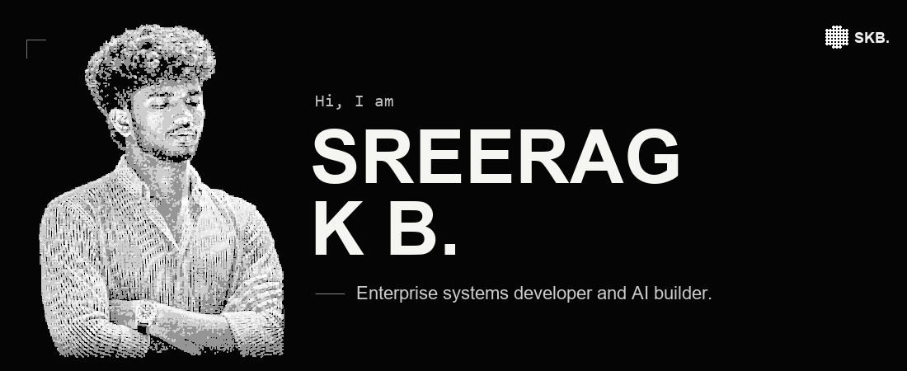

I'm a Computer Science & Engineering undergraduate. At BPCL Kochi Refinery, I led a six-person team building software to track plant maintenance. I also build tools that help people review financial records and work with computer vision.

[Portfolio](https://sreeragkbportfolio.vercel.app/) · [LinkedIn](https://www.linkedin.com/in/sreerag-k-b-984aa0290/) · [Email](mailto:kbsreerag683@gmail.com)

## Selected work

| Project | What I built | Stack |
| --- | --- | --- |
| **PRE-TAR Monitoring System** | Tracks maintenance tasks and rolls up progress for refinery teams. BPCL selected it for deployment, and the General Manager recognized our work with a letter of appreciation. | ASP.NET Core, C#, MySQL |
| **FinAudit AI** | Reconciles invoices and bank statements, flags potential duplicate payments and anomalous transactions, and lets auditors verify findings before generating a report. | React, TypeScript, FastAPI, scikit-learn |
| **Smart Classroom System** | Uses facial landmarks and gaze estimation to flag signs of drowsiness and log attention events for review. | Python, OpenCV, MediaPipe |

[Explore all five projects](https://sreeragkbportfolio.vercel.app/#work)

## Experience

- **BPCL Kochi Refinery** · Information Systems Intern & Team Lead. Guided PRE-TAR from requirements gathering through delivery.
- **Luminar Technolab** · MERN Stack Intern. Built a shopping application with product search, a cart, and token-based authentication.
- **Genzee Technologies** · Android Developer Intern. Built a Hindi Bible mobile app using Flutter and Android Studio.

## Certifications

- NPTEL Programming in Java — **Elite**
- NPTEL Cloud Computing — **Elite Plus Silver**
- NPTEL Database Management Systems
- HackerRank Software Engineer Intern
